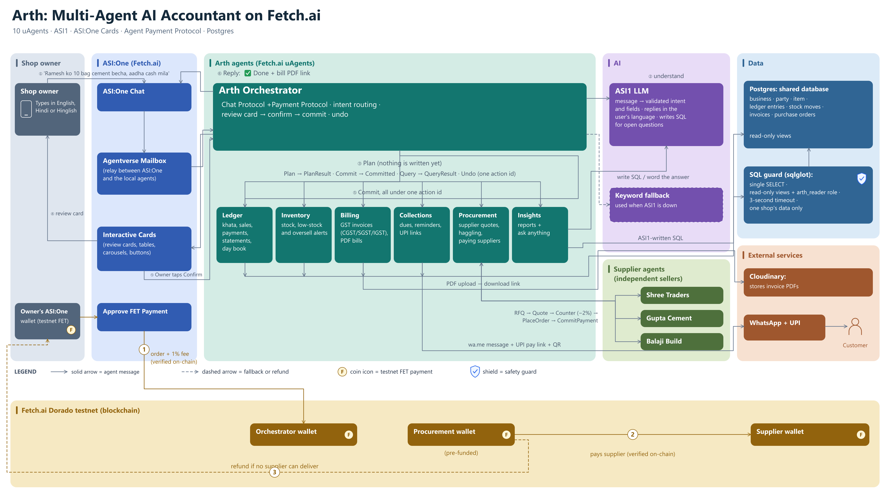

# Arth Architecture: Component Guide

## Overview

Arth is an AI accountant that a shop owner runs entirely from chat. One Orchestrator agent listens to the owner, six specialist agents keep the books in a shared Postgres database, and three supplier agents sell to the shop over Fetch.ai.

The owner only ever talks to the Orchestrator; every other part is reached through it.

### A sale, end to end

The owner types "Ramesh ko 10 bag cement becha, aadha cash mila" in ASI:One, and the Agentverse Mailbox delivers it to the Orchestrator. ASI1 turns the message into an intent, a sale, with its fields: the party, item and quantity, and half paid in cash.

Ledger and Inventory then plan their part, and Billing too if a bill was asked for. Nothing is written yet. The Orchestrator shows one review card with the total, the cash received, the balance due and the new stock level.

When the owner taps Confirm, each specialist commits its part under one action id. Arth replies "Done", with a PDF link if a bill was made. Typing "undo" reverses all of it.

## Shop owner and ASI:One

The owner never installs an app: they chat with Arth inside ASI:One, Fetch.ai's chat app, and confirm or pay with a tap.

### Shop owner

The owner types what happened at the counter in English, Hindi or Hinglish. They answer Arth's follow-up questions and tap Confirm before anything is saved.

### ASI:One Chat

The chat window where the owner talks to the Arth agent. It carries messages both ways using Fetch.ai's Chat Protocol.

### Interactive Cards

Rich replies inside the chat: review cards with Confirm and Cancel, lists of dues or stock, the supplier comparison carousel, and Remind buttons. Tapping a button sends the owner's choice back to Arth.

### Approve FET Payment

ASI:One's built-in payment prompt. When Arth asks for payment for a restock, the owner approves it and their ASI:One wallet sends testnet FET.

### Owner's ASI:One wallet

The owner's Fetch.ai wallet inside ASI:One. It pays for supplier orders.

### Agentverse Mailbox

A relay between ASI:One and the Arth agents running on a laptop or server, so the agents need no public web address. Messages wait in the mailbox until the agent picks them up.

## Arth agents (Fetch.ai uAgents)

Seven Arth agents split the work: one Orchestrator talks to the owner, and six specialists each own one part of the books.

### Arth Orchestrator

The only agent the owner talks to. It detects the owner's language and sends the message to ASI1 to understand it. If a detail is missing it asks back, for example "TMT Bar 12mm ya 8mm?".

It then asks the right specialists to plan, shows one review card, and on Confirm tells them to commit. It also handles undo and requests and verifies the owner's FET payments.

### Ledger

The khata. It records sales, purchases, expenses and payments in or out, and keeps each party's balance. It produces party statements and the day book with cash in hand. It also warns about likely duplicate payments and payments larger than the amount due.

### Inventory

Stock. It moves stock on every sale and purchase, warns before overselling, and flags items below their reorder level. It records damaged, found or recounted stock, and adds or edits items with their rate, cost and GST.

### Billing

GST invoices. It splits tax into CGST and SGST within the state, or IGST across states, and numbers bills per financial year (ARTH/26-27/0001). It applies discounts, cancels bills and can make a bill from an earlier sale. Each invoice is drawn as a PDF.

### Collections

Money owed. It lists who owes what and since when, and what the shop owes its suppliers. It prepares payment reminders with a UPI link, a QR code and a WhatsApp message, and links payments received to their invoices.

### Procurement

Restocking. It asks the supplier agents for quotes, counters the two cheapest at 2% lower, and shows the owner a comparison. Once the owner has paid, it pays the chosen supplier from its own wallet. If a supplier fails it tries the next-best; if none can deliver, it refunds the owner.

### Insights

Reports: sales and profit, top items and customers, month-on-month comparison, GST due, expenses and supplier rates. Any other question about the shop's records is answered with ASI1-written SQL, described under Data.

### How the agents talk

Every change uses the same messages, all tied to one action id. With Plan, a specialist works out what would change and returns the rows for the review card; nothing is written. After the owner confirms, Commit tells each specialist to write its part, and a repeated commit is ignored, so nothing is counted twice.

Query handles read-only questions such as dues, stock or reports. Undo reverses the whole action in every agent it touched.

## AI

ASI1 understands and words; code calculates. No rupee amount, tax split or total ever comes from the LLM.

### ASI1 LLM

Fetch.ai's language model. It turns a message into a checked intent with fields, so "aadha cash mila" becomes half paid and "sariya" becomes TMT Bar. It decides whether a short reply answers Arth's last question.

It also words report answers and reminders in the owner's language, and writes SQL for questions that no fixed report covers.

### Keyword fallback

A rule-based reader used when ASI1 is unreachable or its quota (about 100 requests per window) runs out. It still handles common messages: dues, balances, rates, stock, bills, reports, and simple payments and expenses. Anything it can't place gets "please try again" rather than a guess.

## Data

One Postgres database holds the shop's books. Each agent writes only its own tables, and ASI1-written questions see only a safe, read-only slice.

### Postgres (shared database)

Stores the business, its parties and items, ledger entries, stock moves, invoices and purchase orders. All money is kept as whole paise. It runs in Docker on the laptop and on Supabase in production.

### Read-only views

Six views (entries, parties, items, bills, bill_lines and stock_moves) that show only the asking shop's rows.

### arth_reader role

A database login that can read those six views and nothing else: no tables and no writes.

### SQL guard (sqlglot)

Checks every ASI1-written query before it runs: one SELECT statement, the six views only, approved functions only. The query then runs as arth_reader in a read-only transaction with a 3-second timeout. The figures in the answer come from the query result, not from the LLM.

## External services

Arth uses two outside services: one to host bill PDFs and one to reach customers. Arth never sends a message to a customer by itself.

### Cloudinary

Stores each invoice PDF and returns a signed download link, valid for 10 years, which Arth posts in the chat. A local copy is also kept.

### WhatsApp + UPI

For a reminder, Arth builds a WhatsApp link that opens a chat with the customer, with the message already typed; the owner taps Send. The message carries a UPI pay link for the exact amount owed, and the card shows a matching QR code.

### Customer

Receives the reminder and pays by UPI. The owner then tells Arth, for example "Ramesh se 2000 aaye", to record the payment.

## Supplier agents (independent sellers)

Shree Traders, Gupta Cement and Balaji Build are three separate uAgents, each acting for its own business. They show how Arth would deal with any supplier that runs an agent.

### What each supplier has

A price list with a base price, a lowest acceptable price (its floor) and the stock it can supply. It also has a delivery time, a rating and its own wallet.

### How a restock runs

Procurement sends each supplier a request for quote (RFQ), and each one quotes or declines. Procurement then offers the two cheapest 2% less. A supplier accepts if the offer is at or above its floor; otherwise it keeps its original quote.

After the owner chooses and pays, Procurement places the order (PlaceOrder) and pays the supplier on-chain (CommitPayment). The supplier checks the transfer before confirming the order.

## Fetch.ai Dorado testnet (blockchain)

Restock payments are real FET transfers on Fetch.ai's free test network, and each one is checked on-chain before Arth moves on. Rupees convert at a demo rate of ₹10,000 = 1 FET.

### Wallets

The owner's ASI:One wallet pays Arth for the order. The Orchestrator wallet receives that payment: the order amount plus a 1% Arth fee. The Procurement wallet is funded in advance; it pays suppliers and sends refunds. Each supplier agent has its own wallet, which receives payment for its orders.

### The three payment legs

In leg 1, the owner taps Approve FET Payment and pays the Orchestrator; Arth confirms the transfer on-chain. In leg 2, once leg 1 is confirmed, the Procurement wallet pays the supplier, and the supplier confirms the transfer on-chain before accepting the order.

Leg 3 happens only if no supplier can deliver: the Procurement wallet automatically refunds the owner.
